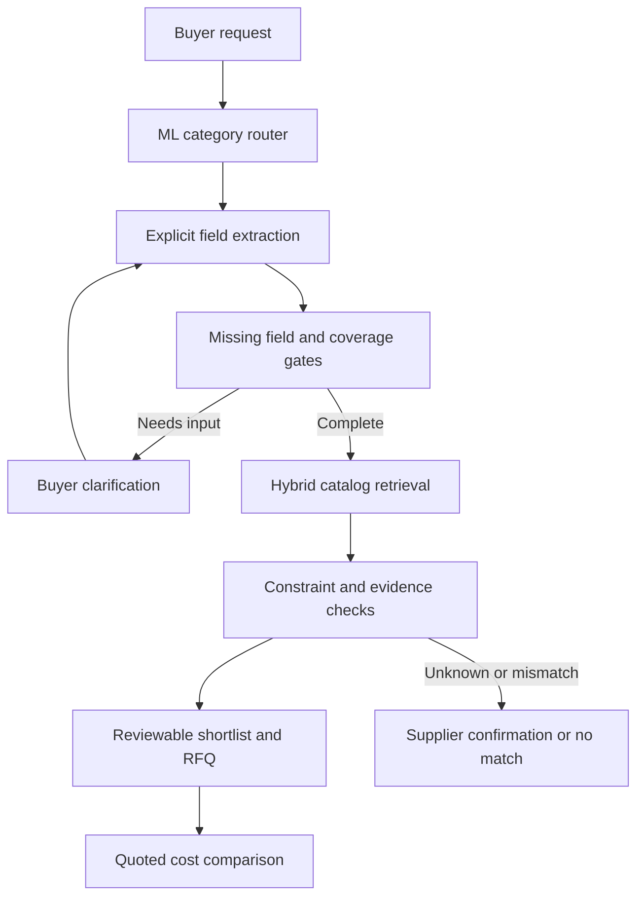

# SahiRFQ

**Clarify the buyer's requirement before recommending a supplier.**

SahiRFQ is an AI/ML B2B sourcing prototype built for an Assistant Product Manager portfolio. It turns a short English or Hinglish enquiry into a reviewable RFQ, asks about missing specifications, and checks supplier catalog evidence before producing a shortlist.

Example: **“Agra ke liye 3 pieces pump chahiye.”** The system asks for pump type, power and electrical phase. After the buyer specifies a 2 HP single-phase submersible pump, it excludes three-phase products, checks MOQ and lead time, and flags catalogs where phase is unknown.

**Scope:** 5 product categories, 30 fictional catalog records, 200 seed/template training examples, and 48 separately authored regression scenarios. No IndiaMART internal data or real supplier records are used. This is an independent educational project, with AI-assisted implementation, prepared for Mayank Nigam.

## What works

- **Supervised ML:** word and character TF-IDF features with a trained logistic regression category router. Coverage and ambiguity gates can abstain.
- **Vector retrieval:** word TF-IDF, typo-tolerant character TF-IDF, and learned 16-dimensional LSA catalog vectors. Each score is inspectable.
- **Clarification:** missing category specifications remain null. Questions are prioritized using field importance and catalog partition entropy.
- **Constraint checking:** exact declared specifications, quantity unit, MOQ, lead time, explicit budget scope, and local-only delivery preference. Every check is `pass`, `fail`, or `unknown`.
- **Grounded catalog QA:** local extractive answers with field-level citations. Optional OpenAI Structured Outputs select retrieved evidence; the application rejects IDs, fields or values absent from the retrieved catalog.
- **Quote completeness:** compare explicit goods, tax and freight amounts. An unknown cost stays unknown and prevents a lowest-total claim.
- **Product demo:** local web interface, buyer answers, supplier explanations, RFQ text export, and an evaluation screen.

## Run locally

Python **3.12** is the tested version. Clone or extract the whole project, then run from its root.

### Windows PowerShell

```powershell
py -3.12 -m venv .venv
.\.venv\Scripts\python.exe -m pip install -r requirements.txt
.\.venv\Scripts\python.exe -m sahirfq.server
```

Open **http://127.0.0.1:8000**. No API key is needed for ML routing, matching, clarification, RFQ export, or local catalog answers. Stop with Ctrl+C. If Python 3.12 is your default Python, `python -m venv .venv` also works.

### macOS / Linux

```bash
python3 -m venv .venv
.venv/bin/python -m pip install -r requirements.txt
.venv/bin/python -m sahirfq.server
```

Use `--port 8001` if port 8000 is occupied. The server binds to localhost and is intended for a local demo, not public production hosting.

## A 90-second demo

1. Start with **Vague pump**. Show the missing specifications and absence of a shortlist.
2. Answer pump type **submersible**, power **2**, and phase **single**. Apply the buyer answers.
3. Open the field checks for **P02**: the wrong electrical phase excludes it. **P06** has unknown phase and cannot become a confirmed match.
4. Ask **“What is the MOQ?”** and inspect the citation. Ask **“Does P01 have a warranty?”** to show abstention.
5. Select **Safety gloves**, enter quote tax/freight amounts, and show that a lower base price can have a higher complete quoted total. Leave one cost blank to show why the system withholds a cheapest-total claim.
6. Open **Evaluation** and explain the dataset limitations.

## Reproduce the checks

```bash
python -m unittest discover -s tests -v
python scripts/evaluate.py
python scripts/inspect_ml.py
```

On Windows without activating the environment, replace `python` above with `.\.venv\Scripts\python.exe`.

Checked in this environment: **26 unit/integration tests passed; 48/48 authored scenario checks passed.** On the 29 fully specified cases, the shortlist returned 23 catalog records and none violated the authored compatible ID sets. The raw word TF-IDF baseline returned 87 records, of which 64 were incompatible. Both achieved the same compatible recall@3 on this tiny fixture set; the measured difference is filtering invalid recommendations, not improved retrieval recall.

See [the full machine-readable evaluation](reports/evaluation.json) and [the evaluation notes](docs/EVALUATION.md). These cases were reviewed during development. They are a regression suite, not an untouched test set. Results do not establish customer conversion, time savings, calibrated confidence, or real marketplace accuracy.

A harder, separately fitted seed-family validation scored **70% category accuracy** on 50 synthetic examples, using 150 other examples for training. That result exposes the router's limited vocabulary generalization. It is recorded in [the model inspection report](reports/model_inspection.json), and is a stronger reason to seek real data than the perfect development scenario pass count.

## Optional LLM RAG

Set the following **server environment variables** before starting the app:

```powershell
$env:OPENAI_API_KEY="YOUR_KEY"
$env:OPENAI_MODEL="YOUR_SUPPORTED_RESPONSES_MODEL"
.\.venv\Scripts\python.exe -m sahirfq.server
```

Use a model in your account that supports Responses API Structured Outputs. Keys stay on the server and must not be committed. `.env.example` is documentation only: the app does **not** automatically load `.env` files. Local matching makes zero LLM calls. Opting into LLM catalog QA sends the question and selected fictional catalog fields to OpenAI; `store` is set to false. Token usage is displayed when returned.

The provider adapter follows [official Structured Outputs documentation](https://developers.openai.com/api/docs/guides/structured-outputs). Its request and validation behavior are tested with mocked responses. A live provider call was **not** run in this build. A supported model and working API key are required to verify it in your account.

## Architecture



Catalog QA is a separate bounded RAG workflow: retrieve catalog records, select evidence, validate exact field values, render a cited answer or abstain. The project does not claim an autonomous sales agent; it makes no supplier contact, payment or ordering action.

## Project map

| File | Purpose |
|---|---|
| `sahirfq/ml.py` | Classifier, TF-IDF vectors, LSA projection and retrieval signals |
| `sahirfq/engine.py` | Extraction, validation, questions, constraint gates and RFQ export |
| `sahirfq/qa.py` | Local answers, optional OpenAI adapter and evidence validation |
| `sahirfq/quotes.py` | Completeness-aware quote cost comparison |
| `sahirfq/server.py` | Local HTTP API and static demo |
| `web/` | Accessible HTML, responsive CSS and vanilla JavaScript UI |
| `data/` | Fictional catalog, training examples, category policies and test scenarios |
| `scripts/evaluate.py` | Reproducible comparison and warm inference timings |
| `scripts/inspect_ml.py` | Grouped synthetic sanity check and learned feature report |
| `tests/` | Workflow, API, cost comparison and grounding failure tests |
| `docs/PRODUCT_BRIEF.md` | User problem, product scope, pilot design and business metrics |
| `docs/INTERVIEW_GUIDE.md` | Explanation, questions, trade-offs and defensible claims |
| `docs/UPLOAD_AND_APPLICATION.md` | GitHub upload steps and form-ready project description |

## Boundaries that matter

The local parser supports a narrow grammar and a limited Hindi/Hinglish vocabulary. It cannot reliably interpret arbitrary language or every engineering specification. Some known unmodeled requirements trigger manual review; this is not a comprehensive detector. Numeric product specifications use **exact equality**, not engineering suitability or minimum-capacity reasoning. Catalog lead times are illustrative declared values, not delivery guarantees. Prices exclude tax and freight. Unknown supplier attributes need confirmation. Logistic regression probabilities are not calibrated for real traffic. LSA vectors are linear statistical projections, not transformer embeddings.

The repo can be shared on GitHub, but GitHub Pages alone cannot run the Python backend. Running the app locally is the supported demo path. The interface's JavaScript and APIs are tested; visual browser inspection was blocked by this build environment's browser access/download restrictions.

## Why this problem

IndiaMART already describes AI-driven RFQ enrichment and matchmaking in its [published investor material](https://ir-docs.s3.ap-south-1.amazonaws.com/Indiamart-Intermesh-Ltd./ppt/Indiamart-Intermesh-Ltd._Q22023_ppt.pdf), pages 17-18 of the PDF. This project explores a specific product question within that workflow: **what evidence is needed before an incomplete enquiry becomes a supplier recommendation?** It does not claim a new category of product or a proven gap in IndiaMART's current systems.

MIT licensed. Catalog and training data are authored fictional examples under the same license.
